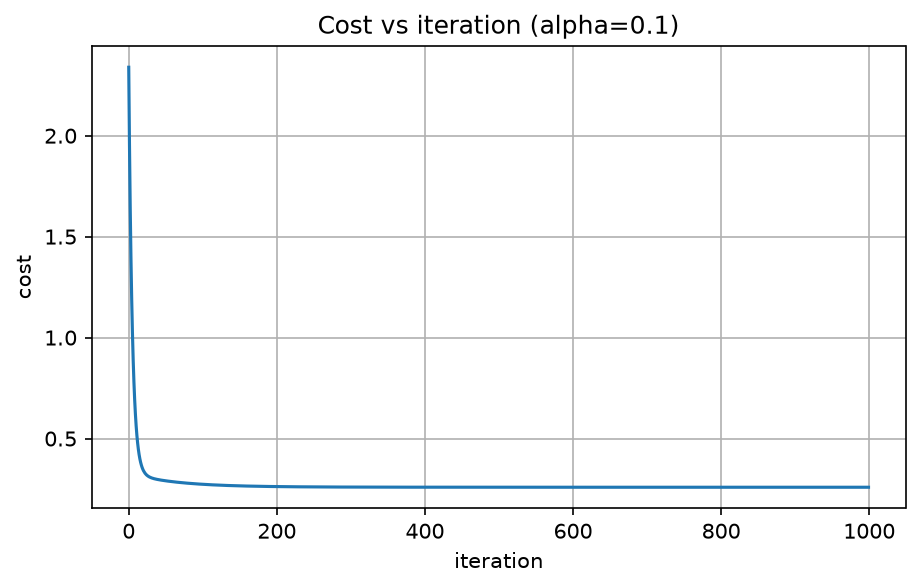

# Week 2: California Housing, Multiple Linear Regression

Linear regression with 8 features, written from scratch in NumPy (vectorized gradient descent, z-score scaling, one engineered feature) and checked against scikit-learn.

## Problem
Predict the median house value of a California census block from 8 numeric features.

## Dataset
California Housing, loaded with `sklearn.datasets.fetch_california_housing`: 20,640 rows, 8 features, no missing values.
Target: `MedHouseVal`, in units of $100,000.
Source: https://scikit-learn.org/stable/datasets/real_world.html#california-housing-dataset

## Method
1. **Split:** 80% train, 20% test (`random_state=42`). The split is done before any scaling.
2. **Scale:** z-score, `(x - mean) / std`, with mean and std computed from the training set only and reused for the test set (no leakage).
3. **Model:** `prediction = X @ w + b`, one weight per feature.
4. **Cost:** squared error, `J = (1/2m) * sum((prediction - y)^2)`.
5. **Gradient descent (vectorized, no loops over rows or features):**
   `dw = X.T @ err / m`, `db = err.sum() / m`, then `w -= alpha * dw`, `b -= alpha * db`.
   Settings: alpha = 0.1, 10,000 iterations, starting from zero weights.
6. **Engineered feature:** `BedroomRatio = AveBedrms / AveRooms` (a high share of bedrooms among rooms points to small, crowded housing).
7. **Check:** compare weights and test error with sklearn's `LinearRegression` on the same scaled data.

## Results

### My weights vs sklearn (9 features, scaled data)

| Feature | My weight | sklearn weight |
|---|---|---|
| MedInc | 0.8237 | 0.8237 |
| HouseAge | 0.1142 | 0.1142 |
| AveRooms | 0.2432 | 0.2432 |
| AveBedrms | -0.1193 | -0.1193 |
| Population | -0.0005 | -0.0005 |
| AveOccup | -0.0127 | -0.0127 |
| Latitude | -0.8686 | -0.8686 |
| Longitude | -0.8556 | -0.8556 |
| BedroomRatio | 0.2745 | 0.2745 |

Bias: 2.0719 (mine) and 2.0719 (sklearn). All weight differences are 0.0000 at 4 decimals.
Because the features are scaled, weights are comparable: `MedInc` is the strongest positive driver, and `Latitude` and `Longitude` are strongly negative.

### Test-set performance

| Model | RMSE | R² |
|---|---|---|
| Mine, 8 features | 0.7456 | 0.5758 |
| Mine, 9 features (+ BedroomRatio) | 0.7148 | 0.6153 |
| sklearn, 9 features | 0.7148 | 0.6153 |

The engineered feature lowered test RMSE by 0.031 (about $3,100) and raised R² by 0.040. A typical prediction is off by roughly $71,000.
This gain is measured on a single train/test split, so it may vary on other splits. Cross-validation would be the next step to confirm it.

### Cost curve



The cost drops steeply in the first iterations and then flattens, which means gradient descent converged. Scaling is what lets alpha = 0.1 work smoothly.

## What went wrong
- **Slow convergence on correlated features.** After 1,000 iterations, `AveRooms`, `AveBedrms` and `BedroomRatio` were still up to 0.04 away from sklearn's weights. These columns overlap in information, which makes the cost surface a long, flat valley, and z-score scaling does not fix correlation, only scale. With 10,000 iterations all weights matched sklearn.
- **Typos in keyword arguments** (`apha` instead of `alpha`, `train_siz` instead of `test_size`) caused errors. `test_size` vs `train_size` would also have silently flipped the split, so I now check argument names against the function signature.
- **Limits of the model:** the target is capped at about $500,000 in the census data, a few blocks have extreme values (for example `AveOccup` up to 1243), and a straight-line model handles location (latitude and longitude) only crudely. R² of about 0.6 means roughly 40% of the variation in prices is unexplained.

## How to run
```bash
pip install numpy pandas matplotlib scikit-learn jupyter
```
Open `housing_multi.ipynb` and run all cells from the top. The dataset downloads automatically the first time.