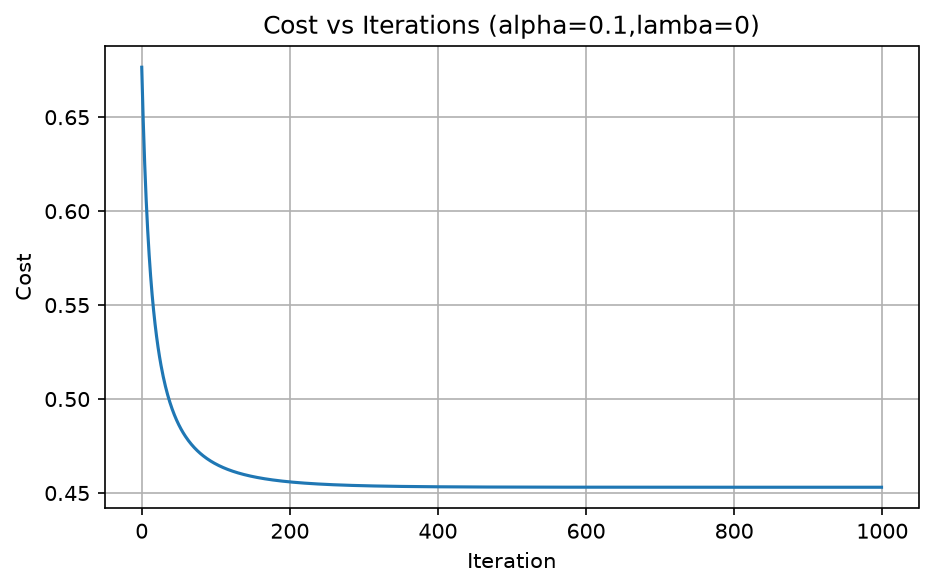
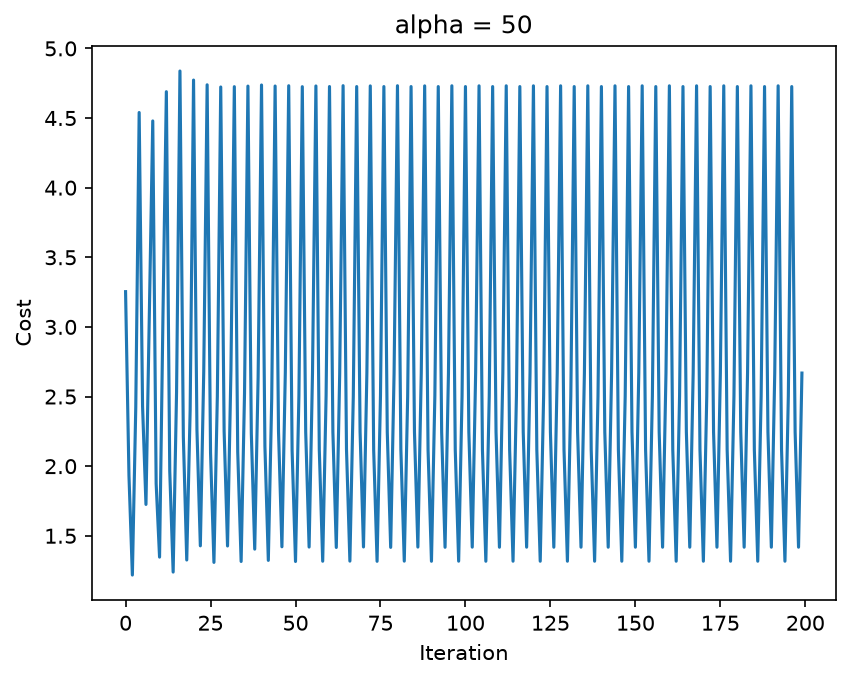
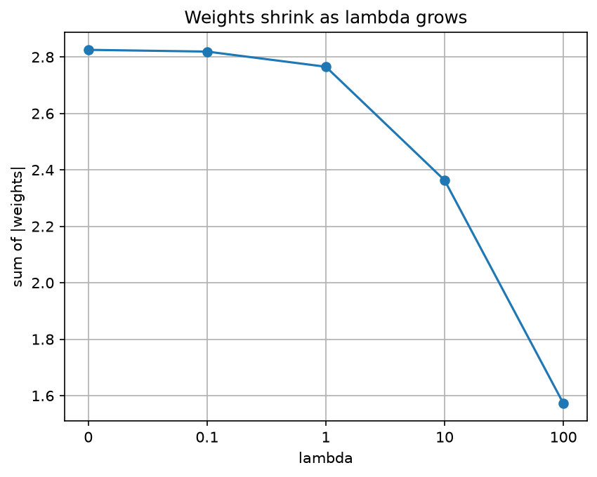

# Week 3: Pima Diabetes, Logistic Regression with L2 Regularization

Logistic regression written from scratch in NumPy (sigmoid, log loss, gradient descent, L2 penalty), checked against sklearn and three other models.

## Problem
Predict whether a patient has diabetes (Outcome = 1) or not (Outcome = 0) from 8 medical measurements.

## Dataset
Pima Indians Diabetes Database, 768 patients, 8 features.
Source: https://www.kaggle.com/datasets/uciml/pima-indians-diabetes-database
Target: Outcome. Class counts: 500 without diabetes, 268 with diabetes.
Zeros in Glucose, BloodPressure, SkinThickness, Insulin and BMI are impossible values, so they were treated as missing and filled with the training-set median.
The CSV is not included in this repo. Download it from the link above.

## Method
1. **Split:** 80% train, 20% test (`random_state=42`, `stratify=Outcome`). The split is done before any filling or scaling.
2. **Fill:** missing values filled with train-set medians only, reused for the test set.
3. **Scale:** z-score, `(x - mean) / std`, with mean and std from the training set only (no leakage).
4. **Model:** `f = sigmoid(X @ w + b)`, written from scratch in NumPy.
5. **Cost:** log loss plus an L2 penalty, `(lambda / 2m) * sum(w^2)`. The bias `b` is not penalized.
6. **Gradient descent:** `dw = X.T @ (f - y) / m + (lambda / m) * w`, `db = mean(f - y)`. Settings: alpha = 0.1, 1000 iterations, weights start at zero.
7. **Experiments:** learning rate (0.001, 0.1, 50), lambda (0, 0.1, 1, 10, 100), and decision threshold (0.5, 0.4, 0.3).
8. **Check:** compared with sklearn's LogisticRegression, Random Forest, SVC and Gradient Boosting on the same split.

## Results

### Test-set performance (threshold 0.5)
| Model | Accuracy | Precision | Recall |
|---|---|---|---|
| **Mine (lambda = 0)** | 0.708 | 0.600 | 0.500 |
| sklearn LogisticRegression | 0.708 | 0.600 | 0.500 |
| Random Forest | 0.773 | 0.702 | 0.611 |
| SVC | 0.740 | 0.652 | 0.556 |
| Gradient Boosting | 0.753 | 0.682 | 0.556 |

A model that always predicts "no diabetes" scores 0.649 accuracy, so every model beats that baseline.

My from-scratch model matches sklearn's LogisticRegression exactly, which confirms the implementation is correct.

### Effect of lambda (alpha = 0.1)
| lambda | Sum of abs(weights) | Test accuracy |
|---|---|---|
| 0 | 2.825 | 0.708 |
| 0.1 | 2.819 | 0.708 |
| 1 | 2.765 | 0.701 |
| 10 | 2.363 | 0.688 |
| 100 | 1.573 | 0.740 |

The weights shrink as lambda grows. The accuracy differences are about 8 patients out of 154, which is within noise on one test split.

### Effect of the decision threshold (my model)
| Threshold | Precision | Recall |
|---|---|---|
| 0.5 | 0.600 | 0.500 |
| 0.4 | 0.614 | 0.648 |
| 0.3 | 0.597 | 0.796 |

Lowering the threshold raised recall from 0.50 to 0.80 with precision staying near 0.60. This was observed on the test set, so a proper choice would use a validation split (Week 6).

### Plots

## What went wrong
- alpha = 0.001 was still improving after 1000 iterations (cost about 0.585), so it had not converged. alpha = 0.1 converged to about 0.453.
- alpha = 50 made the cost bounce instead of settling, because each step overshot the minimum.
- At the default 0.5 threshold, my model's recall was only 0.50, so it missed half of the diabetic patients. Lowering the threshold to 0.3 raised recall to 0.80.
- Accuracy differences between lambda values and between models were small (a few patients out of 154), so they may be noise from a single test split.
- Small bugs along the way: a column name typo, a shape error from scaling twice, and a print statement outside a loop. I fixed each one.

## What I changed from the PDF project
- Wrote logistic regression from scratch instead of only calling sklearn.
- Split the data before filling and scaling, and used train statistics only, so there is no leakage.
- Treated impossible zeros as missing values.
- Reported precision and recall, not just accuracy, and compared against an always-"no" baseline.
- Added experiments on learning rate, lambda and threshold.

## How to run
1. `pip install numpy pandas matplotlib scikit-learn jupyter`
2. Download `diabetes.csv` from the Kaggle link above and place it in this folder.
3. Open `logistic_regression.ipynb` and run all cells from top to bottom.