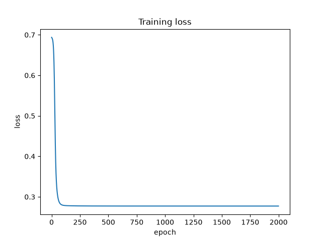

# Week 5: Neural network with manual backpropagation (NumPy)

## Problem
Train a small neural network from scratch in NumPy, with no deep learning library, to separate the two interleaving classes of the "two moons" dataset. The goal is to understand how a network learns: forward pass, loss, backpropagation and gradient descent. A numerical gradient check verifies that my backprop is correct.

## Dataset
Generated with `sklearn.datasets.make_moons` (500 points, noise 0.2, random seed 42). Split 80/20 into 400 training and 100 test points, stratified by class. The classes are balanced, so accuracy is a fair metric here. There is no download link because the data is generated in the notebook.

## Method
- Architecture: 2 inputs → 4 hidden units (ReLU) → 1 output (sigmoid).
- Loss: binary cross-entropy, averaged over the batch.
- Backpropagation written by hand: `dZ2 = A2 - y`, then gradients for each layer, passing the error back through `W2ᵀ` and the ReLU gate.
- Training: plain gradient descent, learning rate 0.5, 2000 epochs, small random initial weights.
- Verification: numerical gradient check, comparing the backprop gradient of `W1` with `(L(w + ε) - L(w - ε)) / 2ε`, using ε = 1e-5.

## Results

| Metric | Value |
|---|---|
| Final training loss | 0.6963 |
| Training accuracy | 0 0.6937 |
| Test accuracy | 0.86 |
| Gradient check (relative difference, `W1`) | 2.1e-10 |



The loss falls quickly in the first few hundred epochs and then flattens. The gradient check is far below the 1e-7 target, so the backprop is correct.

## What went wrong
Write this part in your own words. Things that happened:
- I used the number of examples (400, 100) as weight shapes instead of layer sizes, which caused a matmul shape error.
- I wrote `y_train = y_test.reshape(...)`, which silently put the wrong labels in `y_train`.
- My first `backward` was missing a transpose in `dA1` and summed the bias gradients without `axis=0`.
- `predict` had no `return`, so accuracy printed exactly 0.0. An accuracy of exactly 0.0 or 1.0 usually points to a code bug, not the model.
- I typed `eps = 10-5` instead of `1e-5`, which made the gradient check fail with a relative difference of about 0.2.

## How to run
1. Create a virtual environment and install the requirements:
   ```
   python -m venv .venv
   .venv\Scripts\activate
   pip install -r requirements.txt
   ```
2. Open `backprop.ipynb` and choose the `.venv` kernel.
3. Run all cells from top to bottom.

## What changed from the course version
The course covers forward propagation and uses TensorFlow for training. I added a from-scratch backward pass, a training loop and a numerical gradient check, which the original course version does not include.
